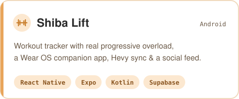
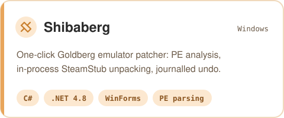
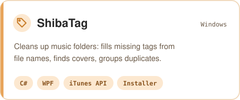
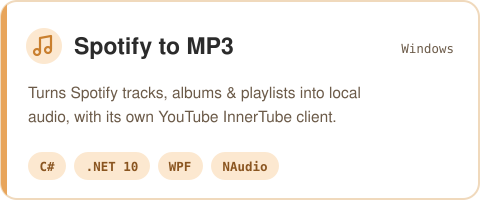
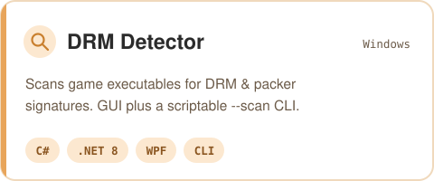
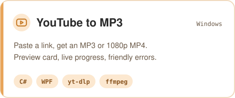

<picture>
  <source media="(prefers-color-scheme: dark)" srcset="assets/banner-dark.svg">
  
</picture>

### 🐾 What I make

Desktop and mobile apps that do one job well: a progressive-overload workout tracker with a watch app, a handful of Windows utilities for music and games, and the low-level bits underneath them — PE parsing, unpacking, and talking to APIs without a wrapper library.

<table>
<tr>
<td width="50%" valign="top">
<a href="https://github.com/iaski15/shiba-lift">
<picture>
  <source media="(prefers-color-scheme: dark)" srcset="assets/card-shiba-lift-dark.svg">
  
</picture>
</a>
</td>
<td width="50%" valign="top">
<a href="https://github.com/iaski15/Shiba-s-Autoberg">
<picture>
  <source media="(prefers-color-scheme: dark)" srcset="assets/card-shibaberg-dark.svg">
  
</picture>
</a>
</td>
</tr>
<tr>
<td width="50%" valign="top">
<a href="https://github.com/iaski15/ShibaTag">
<picture>
  <source media="(prefers-color-scheme: dark)" srcset="assets/card-shibatag-dark.svg">
  
</picture>
</a>
</td>
<td width="50%" valign="top">
<a href="https://github.com/iaski15/Spotify-to-mp3">
<picture>
  <source media="(prefers-color-scheme: dark)" srcset="assets/card-spotify-dark.svg">
  
</picture>
</a>
</td>
</tr>
<tr>
<td width="50%" valign="top">
<a href="https://github.com/iaski15/DRMDetector">
<picture>
  <source media="(prefers-color-scheme: dark)" srcset="assets/card-drm-dark.svg">
  
</picture>
</a>
</td>
<td width="50%" valign="top">
<a href="https://github.com/iaski15/Youtube-to-mp3">
<picture>
  <source media="(prefers-color-scheme: dark)" srcset="assets/card-youtube-dark.svg">
  
</picture>
</a>
</td>
</tr>
</table>

### 🛠️ Toolbox

### 🦴 How I like to build things

- **One file to run.** Self-contained executables and real installers, no "first install these five things".
- **Never lose the user's data.** Backups before patching, journalled undo, duplicates go to the Recycle Bin — not into the void.
- **Do it in-process.** Own InnerTube client instead of shelling out, an unpacker compiled into the app instead of a helper exe.
- **Plain-English errors.** If something fails, the app says why and what to try next.

🐕 every app gets a shiba

